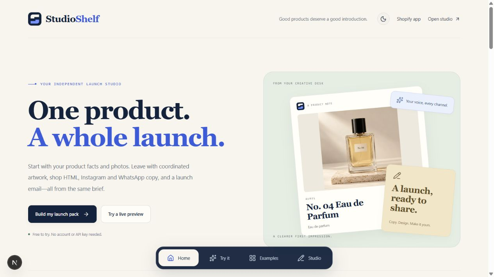

# StudioShelf

A product launch studio for independent sellers. One product brief becomes five coordinated carousel PNGs and a four-channel handoff: shop HTML, Instagram and WhatsApp text, plus launch-email HTML and its subject.

This is a working source-code product, with a no-account demo and optional Gemini / Supabase integrations. It includes no customer base, revenue, marketplace accounts, domain ownership or promised resale value.

## Public interactive demo

Open [StudioShelf on GitHub Pages](https://mustafamgbng.github.io/studioshelf-demo/). This project demonstration supports templates, photo uploads, editing, seller review, browser saves, backups and real downloads. Gemini, cloud accounts and Shopify connections are unavailable on that static host. Work stays in the visitor's browser; export a backup before clearing site data.

The original source repository stays private. The separate [public demo repository](https://github.com/Mustafamgbng/studioshelf-demo) contains compiled website files and media only. Use [the Pages build guide](docs/GITHUB_PAGES.md) to rebuild and update it; the full server application still builds normally for a suitable host.

## Shopify app integration

The embedded workspace is at `/shopify`. It includes product search and variant import, confirmed facts, generation and individual asset regeneration, reusable store branding, shared store kits, ZIP exports, stale-product review, and approved description updates with restoration history. App Bridge supplies fresh identity tokens; the server exchanges them for online Shopify tokens and checks store identity and effective staff permissions on every protected request. No Shopify access token is stored in the database.

Shopify registration, live credentials and development-store tests are deliberately deferred. Without configuration, `/shopify` shows setup guidance and never pretends that a store is connected. The existing `/studio` continues to work without Shopify. Start with the [Shopify setup and test matrix](docs/SHOPIFY.md), then run `npm run check:shopify` before public launch. This release offers a free development beta; hosted AI is disabled by default and no paid plan is offered.

Public pages: `/help`, `/privacy`, `/support`, `/pricing`. Set `STUDIOSHELF_SUPPORT_EMAIL` before inviting merchants. The privacy page describes the implemented data flow and still requires the operator's identity/contact and final review before public distribution.



See the [new creative desk](docs/workspace-overview-light.jpg), [visual editor](docs/workspace-editor-light.jpg), [dark editor](docs/workspace-editor-dark.jpg), [phone editor](docs/workspace-mobile.jpg), [logo and brand guide](docs/BRAND.md), and [image-generation prompts](docs/ASSET_PROMPTS.md). The [private GitHub repository](https://github.com/Mustafamgbng/studioshelf) uses feature branches and pull requests for updates.

The [sample launch kit](demo/sample-launch-kit.zip) is a fresh UI-generated export of the No. 04 fragrance example with three distinct concept photographs assigned across five Editorial slides in Peach studio. It contains five PNGs at 1080 × 1350 pixels, five channel files, launch copy and an editable project backup. Its example.com product destination is a demonstration placeholder. The source includes a [buyer handoff](docs/BUYER_HANDOFF.md) and a [verification report](docs/VERIFICATION.md).

## Quick start

Use Node.js 22.13+ (Node 24 LTS recommended).

```bash
npm install
npm run dev
```

Open http://127.0.0.1:3000 for the product homepage, or go directly to http://127.0.0.1:3000/studio for your creative desk. The homepage has a working playground for three fictional products: headphones, fragrance and an everyday tote. Try carousel, listing and channel previews, change the palette, copy a draft or download a slide. **Edit this kit** carries the selected sample, palette, slide and asset tab into the studio. No environment variables or accounts are needed for template generation, slide editing, local saves and exports.

The creative desk shows the current kit, working examples, its assets and recent browser saves. Open the editor or take the three-step walkthrough. In the editor, use **Design** to change the layout, typography, photo framing, scale, alignment and brand visibility; use **Text** to edit the selected slide. These controls change the exported artwork. Zoom and the large preview help inspect it without changing export dimensions.

Use **Brand studio** for a logo, custom colours, voice and default call to action. Saving a default brand stores it in this browser for new blank kits; existing kits and examples keep their own settings. A project's branding and creative settings also travel with its JSON backup. This browser default is separate from Shopify's store-based branding.

Use the theme control in either view to switch between light and dark interface modes. The preference is remembered in this browser and shared by the homepage and workspace. Interface appearance is separate from the campaign palette used in exported artwork.

On this Windows machine, `START-LOCAL.cmd` can use Codex's bundled modern Node runtime when available. It starts the installed project without changing your system Node configuration. Buyers can use the standard commands above.

For a reproducible install, use pnpm 11 with the included lockfile:

```bash
pnpm install --frozen-lockfile
pnpm dev
```

## What works

- Editorial product homepage with a floating navigation dock and working carousel, listing and channel playground, including copy and PNG downloads.
- Visual creative desk with a current-kit preview, working examples, asset shortcuts, recent saved kits and a three-step walkthrough.
- Original StudioShelf monogram, wordmark and favicon, with photographic AI-generated concept examples.
- Light and dark interface modes, with a remembered browser preference.
- Fact-based template engine that runs locally, clearly labeled separately from AI.
- Gemini server route with image understanding, structured JSON output, bounded input and output validation, provider-error handling and timeouts.
- Four campaign palettes—Graphite, Peach studio, Lilac hour and Field notes—and three creative layouts: Editorial, Spotlight and Gallery. Each kit contains five editable slides at 1080 × 1350 pixels.
- Exported typography, photo framing and scale, text alignment and brand visibility controls, plus preview zoom and a large artwork view.
- Reusable browser-local branding with a raster logo, custom colours, voice and call to action.
- Product-photo uploads (JPEG, PNG and WebP); images are resized in the browser before use.
- Editable listings, highlights, keyword ideas, captions and email copy, with contextual shop, social and email previews.
- Current-session undo/redo and regeneration of one slide, listing or channel while preserving other edited assets. Refreshing or opening a different kit resets undo history.
- Publish pack with four channel previews, HTML/text copy and downloads, actual-file link checks and actionable freshness/review prompts.
- ZIP export containing five PNGs, five channel HTML/text files, Markdown copy, CSV worksheet and editable project backup.
- IndexedDB project shelf with search, reopening, import, export and deletion.
- Optional email/password Supabase accounts and explicit cloud save / load / delete.
- Row-level security and an atomic, per-user daily quota for the deployment owner's Gemini key.
- Responsive workspace, keyboard focus styles, semantic fields, status messages and a modal account dialog.

## Photo library and seller review

The desk preview switches between actual artwork, listing and email drafts, with working slide navigation, copy and download actions. All four asset cards have visual previews and open the matching editor section. Sidebar shortcuts open product photos, the review checklist and downloads.

In **Photos**, upload up to four additional product photos, choose a photo for each slide, use one everywhere or mix photos across the five slides. Reordering preserves assignments; removing a photo returns its slides to the cover. Undo, browser saves and JSON backups preserve these choices. Uploads are resized to fit a shared 1.8M-character image budget. Bundled fragrance concept images demonstrate distinct views; replacing that demo cover with your own photo removes its unrelated bundled gallery images. Additional photos are used for artwork; standalone Gemini receives the brief and cover photo.

**Review** is a saved seller checklist. Confirm facts, resolve questions and inspect each slide. Changes to copy, facts, imagery, branding or design invalidate previous confirmations; undoing those changes restores the matching review. These are seller confirmations, not independent verification. The generation brief is also saved, so outdated-copy warnings survive reopening a kit. Add an optional HTTPS product link under **Audience & call to action**, then regenerate copy to use it.

See [the photographic asset cards](docs/campaign-assets-light.jpg), [phone photo controls](docs/campaign-photos-mobile.jpg) and [the generated photo prompts](docs/ASSET_PROMPTS.md).

## A launch you can hand off

Open **Publish pack** in the editor or sidebar. Preview the actual edited shop listing, Instagram caption, WhatsApp message and launch email. Switch to file contents to inspect or manually copy the export; download one file, the five-file channel pack, or the complete kit with artwork and backup.

Launch checks link to the missing facts, product destination, photo library, stale copy and seller review. The destination check inspects the exported files instead of assuming a newly entered URL is already in every caption. Edited social text is preserved; copy the product link and update the source text or regenerate that asset. Legacy kits without a generation snapshot retain an unknown-freshness warning.

Shop HTML contains an escaped description fragment, not a replacement product page. The context preview shows your photo, while the description file leaves media in your shop. Email HTML is a starting layout for your email provider; add its sender details and required footer. Nothing is posted or sent automatically.

See [the channel handoff](docs/publish-pack-light.jpg), [dark launch checks](docs/publish-pack-dark.jpg) and [phone preview](docs/publish-pack-mobile.jpg).

## Connect Gemini

**Personal / bring-your-own-key use:** open **Connections**, enter your key in the app and choose Gemini in the brief panel. The key lives in the current tab's memory, passes through the app's server to Google, and is not included in projects, backups, or cloud saves. Refreshing clears it. Only use a key on an app deployment you trust.

**Hosted key:** copy `.env.example` to `.env.local`, set `GEMINI_API_KEY` and configure Supabase below. The server refuses to use its hosted key for an anonymous visitor. Verified users consume an atomic allowance of 10 attempts per UTC day. Failed provider calls consume an attempt, preventing retry abuse.

The default is `gemini-3.1-flash-lite`. Model availability and free quotas vary by AI Studio project; override `GEMINI_MODEL` with an enabled text-and-image model supporting structured output. Google documents the [models](https://ai.google.dev/gemini-api/docs/models), [structured-output API](https://ai.google.dev/gemini-api/docs/structured-output), [pricing](https://ai.google.dev/gemini-api/docs/pricing) and [data terms](https://ai.google.dev/gemini-api/terms).

Free-tier inputs may be used to improve Google's products. Use non-confidential material you have permission to share. AI prompts limit invented claims, but they cannot guarantee factual output; human review is required.

## Optional Supabase setup

1. Create a Supabase project in your account.
2. Run `supabase/migrations/001_initial.sql` once in its SQL editor.
3. For standalone email accounts, add the project URL and publishable/anon key as `NEXT_PUBLIC_SUPABASE_URL` and `NEXT_PUBLIC_SUPABASE_ANON_KEY`. Never put a service-role key in either public setting. Shopify's separate server-only store storage uses `SUPABASE_SERVICE_ROLE_KEY` and migration `002_shopify.sql`; see the Shopify guide.
4. Enable email/password authentication. Configure your deployment's Site URL and email confirmation settings in Supabase Auth.
5. Restart/redeploy after changing the public environment variables.
6. Sign up in Connections, confirm your email if required, and sign in. Use **Save current kit to cloud**; find it under **Saved kits → Cloud**.

Cloud save is explicit. Browser projects are not automatically uploaded. Project records include the resized photo. RLS restricts every record to its authenticated owner. Session tokens are managed by Supabase's browser SDK and are separate from the tab-only Gemini key.

See [DEPLOYMENT.md](DEPLOYMENT.md) for Vercel instructions and [docs/VERIFICATION.md](docs/VERIFICATION.md) for the exact test coverage and integration limits.

## Commands

```bash
npm run typecheck
npm test
npm run build
npm start
```

## Project map

```text
app/page.tsx             Product homepage at /
app/studio/page.tsx      Creative workspace at /studio
app/                     Shared layout, styles and Gemini API route
components/editorial-home.tsx  Homepage and working sample playground
components/studio.tsx    Workspace and optional account UI
components/studio-overview.tsx  Creative desk and asset shortcuts
components/creative-controls.tsx  Exported artwork controls
components/local-brand-kit.tsx  Browser-local default brand
components/asset-proof.tsx  Shop, social and email content previews
components/theme-toggle.tsx  Shared light/dark interface control
lib/engine.ts            Template engine and input/output validation
lib/export.ts            Canvas rendering, safe CSV and ZIP export
lib/samples.ts           Fictional product briefs and sample-image lookup
lib/storage.ts           IndexedDB and backup validation
lib/history.ts           Bounded current-session undo/redo
lib/creative.ts          Validated creative settings and image framing
lib/local-brand.ts       Browser default-brand validation and storage
lib/studio-route.ts      Validated playground-to-editor handoff
lib/supabase.ts          Optional authenticated cloud repository
lib/types.ts             Shared domain model and brand palettes
public/samples/          Generated headphones, fragrance and tote concept photos
public/brand/            Original StudioShelf SVG and PNG logo assets
public/sample-mug.svg    Legacy mug illustration for older demo projects
supabase/migrations/     Owner isolation and hosted-key quota
tests/                   Domain, export and mocked API tests
docs/                    Architecture and buyer handoff
```

## Scope and ownership

StudioShelf prepares assets; its shop, social and email previews do not publish or send anything. The configured Shopify app separately supports explicitly approved product-description changes. Keyword ideas are not measured SEO data. The CSV is a content worksheet, not a guaranteed Etsy/Shopify bulk-import format. All sample brands and products are fictional. The legacy mug asset remains available when opening older sample projects. Text that exceeds artwork bounds is shortened in the preview and exported PNG; edit it before publishing.

No Stripe, paid analytics, background workers or image-generation API is required. A production operator still needs appropriate usage limits, provider plans and account configuration. See the deployment guide before enabling a shared server key.

No public open-source license has been added for this project. Choose your commercial distribution and buyer terms before sharing the source publicly. Dependency code retains its own licenses; see [THIRD_PARTY_NOTICES.md](THIRD_PARTY_NOTICES.md).
