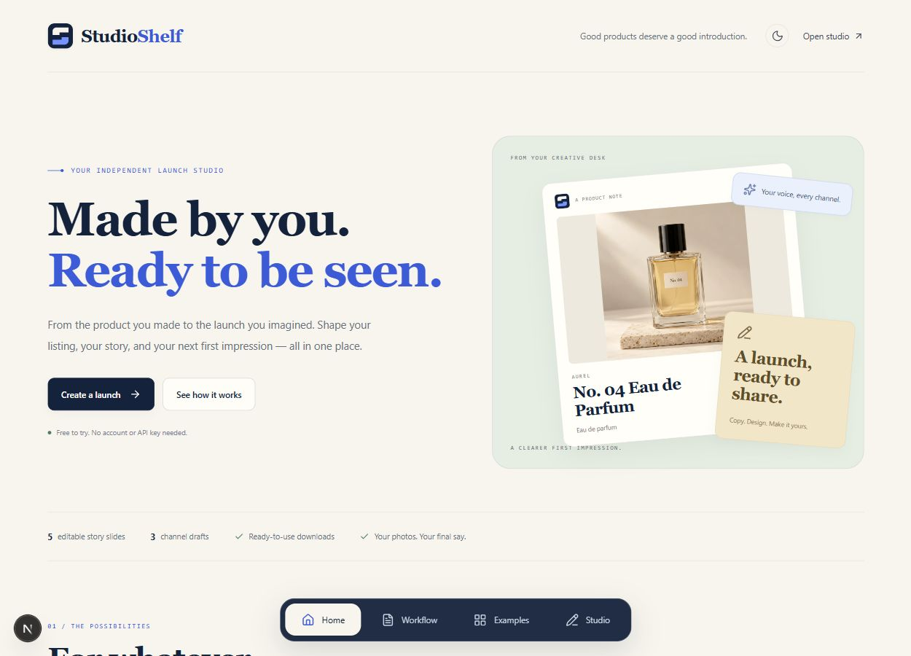

# StudioShelf

A product launch studio for independent sellers. Turn confirmed product facts and a photo into an editable listing, Instagram caption, WhatsApp message, launch email and five coordinated carousel PNGs.

This is a working source-code product, with a no-account demo and optional Gemini / Supabase integrations. It includes no customer base, revenue, marketplace accounts, domain ownership or promised resale value.



See the [dark-mode homepage](docs/preview-dark.png), [studio workspace](docs/studio-preview.png), [logo and brand guide](docs/BRAND.md), and [image-generation prompts](docs/ASSET_PROMPTS.md). The [private GitHub repository](https://github.com/Mustafamgbng/studioshelf) uses feature branches and pull requests for updates.

The [sample launch kit](demo/sample-launch-kit.zip) is a fresh UI-generated export of the No. 04 fragrance example with photographic concept imagery. It contains five PNGs at 1080 × 1350 pixels, launch copy and an editable project backup. The source includes a [buyer handoff](docs/BUYER_HANDOFF.md) and a [verification report](docs/VERIFICATION.md).

## Quick start

Use Node.js 22.13+ (Node 24 LTS recommended).

```bash
npm install
npm run dev
```

Open http://127.0.0.1:3000 for the product homepage, or go directly to http://127.0.0.1:3000/studio for the workspace. The homepage previews three fictional products: headphones, fragrance and an everyday tote. Open an example to start editing it in the studio. No environment variables or accounts are needed for template generation, slide editing, local saves and exports.

Use the theme control in either view to switch between light and dark interface modes. The preference is remembered in this browser and shared by the homepage and workspace. Interface appearance is separate from the campaign palette used in exported artwork.

On this Windows machine, `START-LOCAL.cmd` can use Codex's bundled modern Node runtime when available. It starts the installed project without changing your system Node configuration. Buyers can use the standard commands above.

For a reproducible install, use pnpm 11 with the included lockfile:

```bash
pnpm install --frozen-lockfile
pnpm dev
```

## What works

- Editorial product homepage with a floating navigation dock, interactive sample selection, and direct links into the studio.
- Original StudioShelf monogram, wordmark and favicon, with photographic AI-generated concept examples.
- Light and dark interface modes, with a remembered browser preference.
- Fact-based template engine that runs locally, clearly labeled separately from AI.
- Gemini server route with image understanding, structured JSON output, bounded input and output validation, provider-error handling and timeouts.
- Four campaign palettes—Graphite, Peach studio, Lilac hour and Field notes—and five editable carousel designs at 1080 × 1350 pixels.
- Product-photo uploads (JPEG, PNG and WebP); images are resized in the browser before use.
- Editable listings, highlights, keyword ideas, captions and email copy.
- ZIP export containing five PNGs, Markdown copy, CSV worksheet and editable project backup.
- IndexedDB project shelf with search, reopening, import, export and deletion.
- Optional email/password Supabase accounts and explicit cloud save / load / delete.
- Row-level security and an atomic, per-user daily quota for the deployment owner's Gemini key.
- Responsive workspace, keyboard focus styles, semantic fields, status messages and a modal account dialog.

## Connect Gemini

**Personal / bring-your-own-key use:** open **Connections**, enter your key in the app and choose Gemini in the brief panel. The key lives in the current tab's memory, passes through the app's server to Google, and is not included in projects, backups, or cloud saves. Refreshing clears it. Only use a key on an app deployment you trust.

**Hosted key:** copy `.env.example` to `.env.local`, set `GEMINI_API_KEY` and configure Supabase below. The server refuses to use its hosted key for an anonymous visitor. Verified users consume an atomic allowance of 10 attempts per UTC day. Failed provider calls consume an attempt, preventing retry abuse.

The default is `gemini-3.1-flash-lite`. Model availability and free quotas vary by AI Studio project; override `GEMINI_MODEL` with an enabled text-and-image model supporting structured output. Google documents the [models](https://ai.google.dev/gemini-api/docs/models), [structured-output API](https://ai.google.dev/gemini-api/docs/structured-output), [pricing](https://ai.google.dev/gemini-api/docs/pricing) and [data terms](https://ai.google.dev/gemini-api/terms).

Free-tier inputs may be used to improve Google's products. Use non-confidential material you have permission to share. AI prompts limit invented claims, but they cannot guarantee factual output; human review is required.

## Optional Supabase setup

1. Create a Supabase project in your account.
2. Run `supabase/migrations/001_initial.sql` once in its SQL editor.
3. Add the project URL and publishable/anon key as `NEXT_PUBLIC_SUPABASE_URL` and `NEXT_PUBLIC_SUPABASE_ANON_KEY` in `.env.local` or your hosting environment. **Do not use a service-role key.**
4. Enable email/password authentication. Configure your deployment's Site URL and email confirmation settings in Supabase Auth.
5. Restart/redeploy after changing the public environment variables.
6. Sign up in Connections, confirm your email if required, and sign in. Use **Save current kit to cloud**; find it under **Saved kits → Cloud**.

Cloud save is explicit. Browser projects are not automatically uploaded. Project records include the resized photo. RLS restricts every record to its authenticated owner. Session tokens are managed by Supabase's browser SDK and are separate from the tab-only Gemini key.

See [DEPLOYMENT.md](DEPLOYMENT.md) for Vercel instructions and [docs/VERIFICATION.md](docs/VERIFICATION.md) for the exact test coverage and integration limits.

## Commands

```bash
npm run typecheck
npm test
npm run build
npm start
```

## Project map

```text
app/page.tsx             Product homepage at /
app/studio/page.tsx      Creative workspace at /studio
app/                     Shared layout, styles and Gemini API route
components/landing.tsx   Interactive homepage and product previews
components/studio.tsx    Workspace and optional account UI
components/theme-toggle.tsx  Shared light/dark interface control
lib/engine.ts            Template engine and input/output validation
lib/export.ts            Canvas rendering, safe CSV and ZIP export
lib/samples.ts           Fictional product briefs and sample-image lookup
lib/storage.ts           IndexedDB and backup validation
lib/supabase.ts          Optional authenticated cloud repository
lib/types.ts             Shared domain model and brand palettes
public/samples/          Generated headphones, fragrance and tote concept photos
public/brand/            Original StudioShelf SVG and PNG logo assets
public/sample-mug.svg    Legacy mug illustration for older demo projects
supabase/migrations/     Owner isolation and hosted-key quota
tests/                   Domain, export and mocked API tests
docs/                    Architecture and buyer handoff
```

## Scope and ownership

StudioShelf prepares assets; it does not automatically publish to social networks or marketplaces. Keyword ideas are not measured SEO data. The CSV is a content worksheet, not a guaranteed Etsy/Shopify bulk-import format. All sample brands and products are fictional. The legacy mug asset remains available when opening older sample projects. Text that exceeds artwork bounds is shortened in the preview and exported PNG; edit it before publishing.

No Stripe, paid analytics, background workers or image-generation API is required. A production operator still needs appropriate usage limits, provider plans and account configuration. See the deployment guide before enabling a shared server key.

No public open-source license has been added for this project. Choose your commercial distribution and buyer terms before sharing the source publicly. Dependency code retains its own licenses; see [THIRD_PARTY_NOTICES.md](THIRD_PARTY_NOTICES.md).
